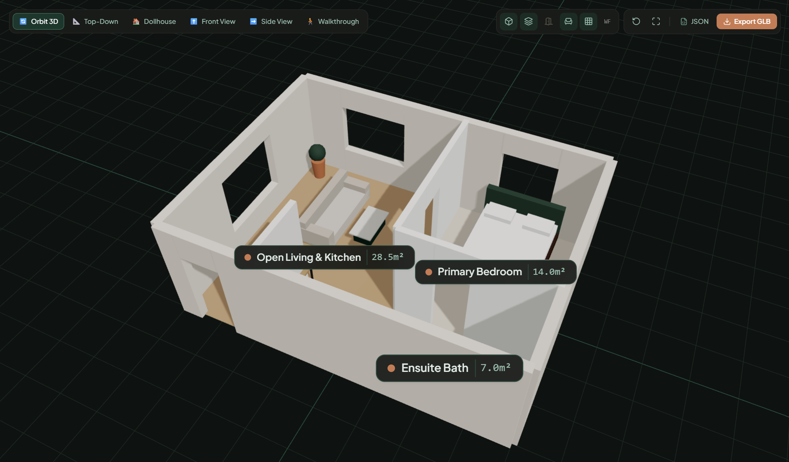

# Plan2Reality 

<p align="center">

</p>

> AI-Powered 2D Architectural Floor Plan to Interactive 3D Building Visualiser

Plan2Reality is a modern full-stack web application that transforms 2D architectural blueprints and sketches (PNG, JPG, JPEG, PDF) into realistic, interactive 3D spatial models.

---

## 🏛️ Architecture & Tech Stack

```
Plan2Reality 
├── frontend/        # React + Vite + TypeScript + Tailwind CSS + React Three Fiber + Framer Motion
├── backend/         # Node.js + Express + MongoDB (Mongoose) + JWT Auth + Multer
├── ai-service/      # Python + FastAPI + OpenCV + NumPy + Pillow (Computer Vision pipeline)
├── samples/         # Real 2D floor plans and benchmark blueprints
└── docs/            # Architecture, API specifications, and geometry schema documentation
```

### Key Technologies

- **Frontend**: React 18 / 19, Vite, TypeScript, Tailwind CSS, Framer Motion, Lucide React, React Three Fiber (R3F), Three.js, `@react-three/drei`.
- **Backend**: Node.js, Express, MongoDB with Mongoose, JWT authentication, bcrypt, Multer, Helmet, CORS, express-rate-limit.
- **AI / Computer Vision**: Python 3, FastAPI, OpenCV, NumPy, Pillow, Pydantic geometry validation.
- **3D & Export Engine**: Three.js GLTFExporter (GLB/glTF), calibrated JSON geometry format.

---

## 🚀 Getting Started

### Prerequisites

- **Node.js**: v18+ (v20+ recommended)
- **npm** or **pnpm**
- **Python**: 3.10+
- **MongoDB**: Local instance or MongoDB Atlas URI

### 1. Frontend Setup

```bash
cd frontend
npm install
npm run dev
```
Open [http://localhost:5173](http://localhost:5173).

### 2. Backend Setup

```bash
cd backend
npm install
cp ../.env.example .env
npm run dev
```
API running on [http://localhost:5000](http://localhost:5000).

### 3. AI Computer Vision Service Setup

```bash
cd ai-service
python -m venv venv
# Windows:
.\venv\Scripts\activate
# Linux/Mac:
source venv/bin/activate
pip install -r requirements.txt
python -m uvicorn app.main:app --reload --port 8000
```
FastAPI docs available at [http://localhost:8000/docs](http://localhost:8000/docs).

---
